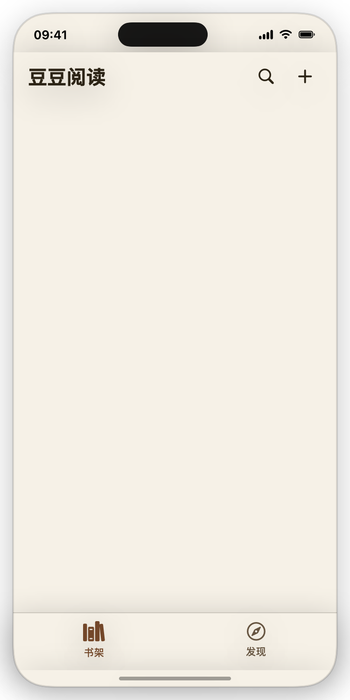
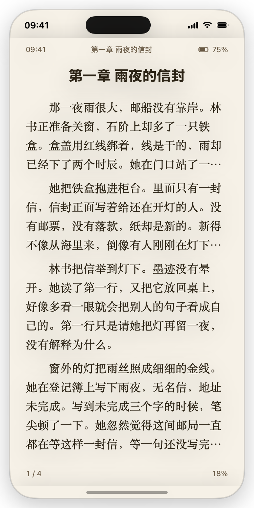
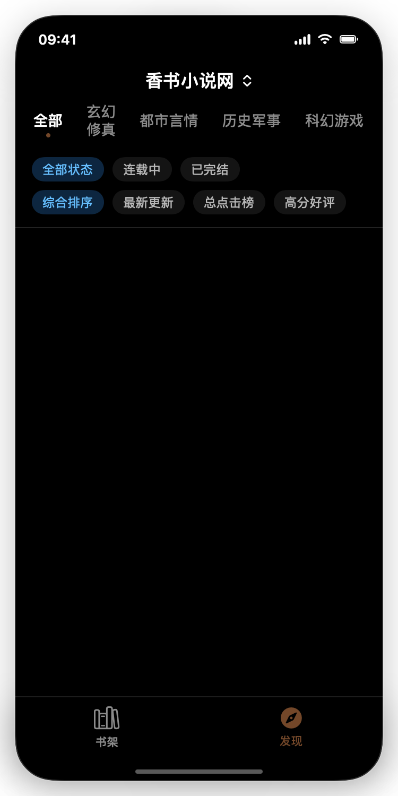
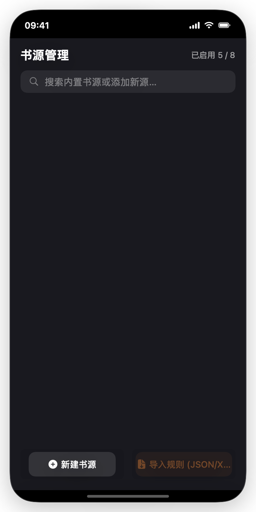

# 豆豆阅读 (DouDouReader)

<p align="center">
  
</p>

<p align="center">
  <b>一款为沉浸阅读与极速响应而生的多平台小说阅读器</b><br>
  <i>基于 SwiftUI & SwiftData 原生打造 · 适配 iOS / macOS / iPadOS / visionOS</i>
</p>

<p align="center">
  
  
  
  
  
</p>

---

## 📱 界面预览

| 书架主页 | 沉浸阅读 | 发现与找书 | 书源管理 |
| :---: | :---: | :---: | :---: |
|  |  |  |  |
| 暖纸色质感 · 置顶追更 · 接着读 | 纸白排版 · 多维定制 · 极简模式 | 分类探索 · 多源聚合 · 实时热搜 | 阅读 3.0 / 香色兼容 · 测速调度 |

---

## ✨ 核心特性

### 📖 极度舒适的阅读排版
- **TextKit 原生高保真分页**：精确定位页面边界，翻页迅速，不漏字不溢出。
- **多种翻页动画**：支持仿真翻页、左右滑动、垂直连续滚动及无动画极速切页。
- **6 套考究主题配色**：纸白、护眼、羊皮、烟灰、夜间，以及随系统自适应的“自动”外观。
- **全方位排版定制**：字号、行距、段间距、首行缩进、字距、对齐方式、四周边距细调。
- **极简模式**：轻点屏幕中央隐去所有页眉页脚与工具栏，边缘点按无感翻页，还你无干扰的纯粹阅读空间。
- **字型自由扩展**：支持直接导入外部 `.ttf` / `.otf` 自定义字体文件。
- **简繁体一键切换与屏蔽词过滤**：内置高效字典映射与预编译屏蔽词正则清洗。

### ⚡ 毫秒级解析与高性能架构
- **智能编码识别**：自动探测并适配 UTF-8（含 BOM）、UTF-16、GB18030 等中文小说常见格式。
- **正则预编译分章池**：内置常用大章、卷、序章、番外智能分章表达式，使用预编译 `NSRegularExpression` 缓存池，几万章巨作毫秒级分发，彻底消除主线程卡顿。
- **轻量 EPUB 流式解压**：仅提取核心元数据、`container.xml`、`content.opf` 及正文 XHTML，跳过海量高清多媒体解压开销，内存占用极低。
- **防抖防雪崩搜索**：多源聚合搜索支持 400ms 智能防抖（Debounce）与 Task 取消链路，杜绝高频敲击时的多源并发请求雪崩。
- **SwiftData 批量写入调优**：全本缓存采用分批写入（Batch Commit），将百万字数千章的落盘事务合并处理，避免高频 I/O 导致 UI 掉帧。

### 📚 智能书架与追更系统
- **多元管理**：支持置顶小说、按“最近阅读/加入时间/书名”智能排序。
- **视图切换**：提供雅致大封面网格与精简列表两种模式。
- **断点续读与进度管理**：无论本地书目还是网络章节，实时记录最后阅读位置与全本百分比。
- **后台智能追更**：单本或一键全书架后台检查目录更新，有新章节时自动展现醒目更新角标。

### 🌐 强大的开放书源生态
- **多标准兼容**：全面兼容「阅读 3.0」规则与「香色闺阁」源，支持本地 `.xbs`、`.json` 文件导入或网络 URL 一键订阅。
- **内置精品目录**：预设常用精选站点，开箱即搜即读。
- **灵活的源管理**：支持分组管理、一键启停、优先级权重调控、网络响应测速与自适应调度。
- **全本离线高速缓存**：4 路并发极速下载，支持断点续传（自动跳过已缓存章节），并在书架提供可视化缓存占用监控与一键清理。

### 🎧 语音听书（TTS）与后台播放
- **系统级朗读**：基于 `AVSpeechSynthesizer`，支持后台锁屏播放、线控与控制中心联动。
- **多音色与精准调速**：系统中文音色随意切换，支持 0.32–0.80 倍速无极调节。
- **双维度切段**：支持“按页”或“按章”无缝跳转段落。
- **音频中断保护**：朗读过程中音频会话被中断（蓝牙断开、来电、其他 App 抢占）时自动暂停（不停止、不自动恢复），并弹窗「朗读被中断，是否退出朗读？」，用户可选择「继续朗读」或「退出朗读」；中断结束仅重新激活音频会话，不自动恢复朗读；仅 iOS/visionOS 注册 AVAudioSession 中断监听（macOS 不适用）。

---

## 🛠️ 环境要求

| 项目 | 要求 |
| :--- | :--- |
| **开发环境** | Xcode 16.0+ |
| **编程语言** | Swift 5.10 / Swift 6 兼容 |
| **支持平台** | iOS 17.6+ / macOS 15.0+ / visionOS 1.0+ |
| **工程文件** | `DouDouReader.xcodeproj`（采用 Xcode 现代化同步目录结构） |

---

## 🚀 编译与运行

### 1. 使用 Xcode 打开
1. 双击打开 `DouDouReader.xcodeproj`。
2. 在顶部 Scheme 中选择 `DouDouReader`。
3. 目标设备选择 **iPhone 模拟器 / 真机**、**My Mac** 或 **visionOS 模拟器**。
4. 按 `Cmd + R` 即可运行。

### 2. 命令行快速构建
```bash
# 构建 macOS 目标
xcodebuild -project DouDouReader.xcodeproj -scheme DouDouReader -destination 'platform=macOS' -configuration Debug build
```

### 3. 自动化测试与诊断
DouDouReader 内置了完备的自动化自检工具：

- **基础逻辑自检**（校验分章、分页、编码、简繁、ATS、书源解析器）：
  ```bash
  /path/to/DouDouReader.app/Contents/MacOS/DouDouReader -selfTest
  # 校验通过控制台打印：LOGIC_OK
  ```
- **生成高保真预览截图**：
  ```bash
  /path/to/DouDouReader.app/Contents/MacOS/DouDouReader -renderScreenshots
  ```
- **直接进入发现页**：
  ```bash
  /path/to/DouDouReader.app/Contents/MacOS/DouDouReader -openSources
  ```

---

## 📂 项目结构

```text
DouDouReader/
├── App/                # 应用程序生命周期、入口与全局外观
├── Library/            # 书架模型、书籍存储 (BookStorage)、示例图书、本地文件导入
├── Text/               # 正文解码 (EncodingDetector)、分章器 (ChapterSplitter)、简繁转换、TextKit 分页引擎
├── Reader/             # 阅读器主界面、排版菜单、主题色彩、TTS 听书控制器
├── BookSource/         # 书源规则引擎 (BookSourceEngine)、XPath/JSONPath 抓取器、内置源与订阅管理器
├── Diagnostics/        # 自动化自检 (-selfTest) 与高保真截图生成器 (-renderScreenshots)
└── Assets.xcassets/    # 图标、色板与应用素材
```

---

## 🔒 隐私与数据存储

- **完全本地化**：用户的书架、书签、书源配置均保存在本地 `SwiftData` 容器中。
- **文件沙盒存储**：书籍文件与导入的外部字体均安全保存在系统沙盒的 `Application Support/DouDouReader/` 目录下，不产生冗余残留。
- **网络安全性 (ATS)**：应用支持 HTTPS 书源及经用户许可的自定义/内置网络源请求，无多余隐私追踪与第三方 SDK 依赖。

---

## 📄 开源协议

本项目采用 [MIT License](LICENSE) 开源协议，欢迎交流学习与提交 PR！
